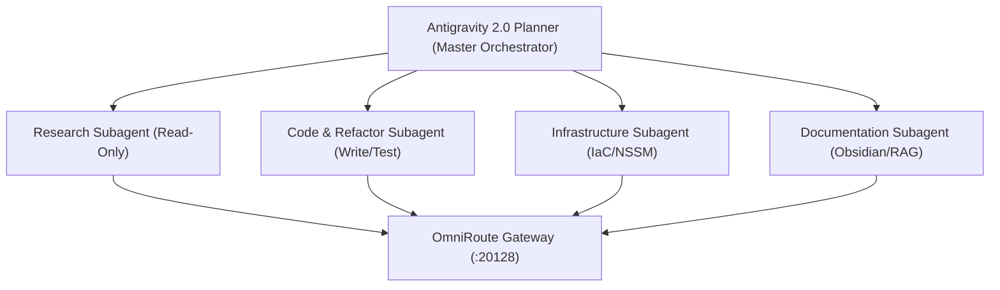

# AI Workstation Master Agents Manifest (AGENTS.md)

**System:** `primary-workstation-node`  
**Control Plane:** Google Antigravity 2.0  
**Authority:** Principal AI Systems Architect & Chief Infrastructure Intelligence Engineer  
**Date:** November 9, 2026  

---

## 1. Executive Role & Council Charter

The AI Workstation operates as an autonomic, multi-agent council coordinated by **Google Antigravity 2.0**.
Each agent possesses explicit operational boundaries, tool access grants, model routing tiers, and completion criteria.

---

## 2. Defined Agent Council Roles

### 1. `Master Orchestrator` (Antigravity 2.0 Primary Agent)
- **Role:** High-level task decomposition, goal tracking, verification gating, user alignment.
- **Model:** `gemini-3.8-flash-high` or `claude-sonnet-4-6` (via OmniRoute / Native Antigravity).
- **Execution Style:** Goal-driven, verifiable checks (`[Step]` &rarr; verify `[check]`), YAGNI compliance.
- **Boundary:** Never executes massive batch refactoring directly without decomposing tasks into scoped subagents or artifacts.

### 2. `Codebase Researcher` (`research` Subagent)
- **Role:** Broad multi-file exploration, AST symbol lookup, grep scanning, and dependency mapping.
- **Model:** `flash_lite` or `flash` (low-token, high throughput).
- **Tool Access:** Read-only tools (`read_file`, `search_web`, `read_resource`).
- **Boundary:** Strictly prohibited from creating, modifying, or deleting any file on disk.

### 3. `Platform & Infrastructure Specialist` (Self / IaC Subagent)
- **Role:** Docker Compose maintenance, NSSM service management, PowerShell bootstrap, multi-tier backups.
- **Model:** `gemini-3.8-flash-high`.
- **Tool Access:** Read/Write, `run_command` (PowerShell, Git, Docker, NSSM).
- **Boundary:** Must adhere to zero-data-loss guidelines. User approval required before any service deletion or storage repartitioning.

### 4. `Knowledge & Semantic RAG Architect`
- **Role:** Obsidian vault taxonomy enforcement, frontmatter validation, RAG document chunking, and MkDocs site building.
- **Model:** `gemini-3.8-flash-low`.
- **Tool Access:** Markdown editing, frontmatter linting, indexing scripts.
- **Boundary:** Ensures no raw session logs containing sensitive API keys or personal chat history enter the `Knowledge-Repository`.

---

## 3. Subagent Spawning Discipline & Completion Protocol

Every subagent invoked on this workstation must adhere to the standard three-part contract:

1. **Clear Input Scope:** Explicit target file paths, directories, and branch boundaries.
2. **Deterministic Deliverables:** Concrete outputs (e.g., "return JSON array of symbols and line ranges").
3. **Strict Termination:** Must exit cleanly upon task fulfillment without speculative follow-on actions.

---
*Maintained under Google Antigravity 2.0 Autonomous Command Plane*
